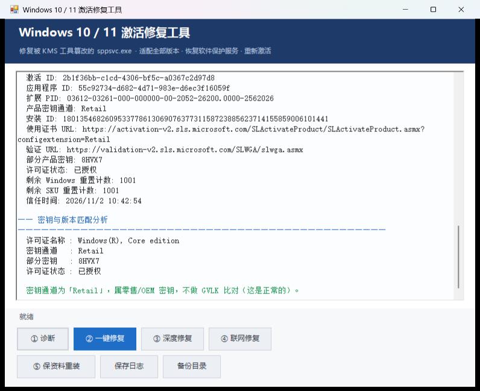

# Windows 激活修复工具

> 修复被第三方 KMS 激活工具篡改的 Windows 授权组件 —— 图形界面、一键操作、不破坏系统。


---

## 这是什么问题

如果你遇到过下面这些症状，这个工具就是为你写的：

- 点「设置 → 更新和安全 → 激活」，**界面卡住不动**或直接打不开
- 命令行运行 `slmgr /dlv`、`slmgr /xpr`，**没有任何输出、一直卡着**
- 提示 `0xC004F069`：「在运行 Microsoft Windows 非核心版本的计算机上运行 slui.exe」
- 服务列表里 `Software Protection`（`sppsvc`）**无法启动**，每 5 分钟报一次事件 7000
- 装过 KMS 类激活工具之后，本来正版的系统突然变成"未激活"

**根因通常只有一个**：`C:\Windows\System32\sppsvc.exe`（软件保护服务主程序）被换成了签名无效的修改版。

```
第三方 KMS 工具替换 sppsvc.exe
        ↓
数字签名失效 → Windows 拒绝加载该服务
        ↓
软件保护服务无法启动（SCM 事件 7000）
        ↓
授权信息读不出来 → 显示未激活 / slmgr 卡死 / 报非核心版本
```

## 界面



## 五个功能

| 按钮 | 作用 | 适用场景 |
|---|---|---|
| **① 诊断** | 只读检查：版本、服务、签名、组件库、激活详情 | 先看现状，不改任何东西 |
| **② 一键修复** | 从组件库还原原版 `sppsvc.exe` → 重启服务 → 重新激活 | 组件库里有签名有效的副本 |
| **③ 深度修复** | `slmgr /rearm` 重置授权 → 重启服务 → 重新激活 | 文件已修好但仍显示未激活 |
| **④ 联网修复** | `DISM /RestoreHealth` → `sfc /scannow` → 自动重试 | 组件库副本也被改坏，本地没有可信来源 |
| **⑤ 保资料重装** | 挂载官方 ISO → 就地升级修复 | 以上都无效，需要彻底修复系统 |

## 支持的系统

- Windows 10（含 LTSC 2019 / 2021）
- Windows 11（含 LTSC 2024）
- Windows Server

覆盖全部客户端版本：家庭版、家庭中文版、家庭单语言版、专业版、专业教育版、专业工作站版、教育版、企业版、企业版 LTSC、企业多会话版、IoT 企业版，以及所有 N 变体。

工具按 `CurrentBuild` + `InstallationType` 自动识别，不需要手工选择版本。

## 快速开始

```powershell
# 1. 下载或克隆本仓库
git clone https://github.com/<your-name>/windows-activation-repair.git

# 2. 双击 run-fix.bat（会自动请求管理员权限）
#    或在管理员 PowerShell 中：
.\run-fix.bat
```

推荐顺序：

```
① 诊断
  ├─ 组件库有 ✓   →  ② 一键修复
  ├─ 组件库全 ✗   →  ④ 联网修复（完成后自动接 ②）
  └─ ② 之后仍未激活 →  ③ 深度修复
以上都无效        →  ⑤ 保资料重装
```

完整说明见 [docs/使用说明.md](docs/使用说明.md)。

## 工作原理

### 为什么是替换文件而不是"重新激活"

数字许可证（HWID）绑定主板，微软服务器上的授权记录**不会因为本地文件损坏而消失**。所以问题从来不是"授权丢了"，而是"本机读不出授权"。把原版文件放回去，授权自然就能读到了。

### 组件库副本怎么选

Windows 的系统文件在 `C:\Windows\WinSxS` 里有一份"原件"，`System32` 里的通常是指向它的**硬链接**。工具按这个顺序选源：

1. 签名必须 `Valid`，签发者须为 Microsoft
2. 修订号（UBR）与当前系统一致的优先
3. 其次同 build 家族，再其次更低 build，最后才是更高 build

> 注意：篡改工具如果是**原地修改**，硬链接会让 `WinSxS` 里那份一起变脏——这种情况下本地就没有可信来源了，必须走 ④ 联网修复。

### 为什么版本要按 UBR 比而不是 build

Windows 组件版本是 `10.0.<分支build>.<修订号>`。分支 build 在整个服务周期内固定不变（例如 Win11 24H2 一直是 `26100`），实际更新体现在修订号上。系统 `Build 26100.9711` 对应的组件就是 `10.0.26100.9711`。

## 安全设计

这个工具会修改系统文件，所以每一处都做了防御：

- **签名闸门**：源文件签名不是 `Valid` 就拒绝替换，绝不"用坏文件覆盖好文件"
- **强制备份**：原文件先备份到 `C:\Windows\Temp\ActivationFixBackup\`
- **超时保护**：`slmgr` 调用限时 35~90 秒，超时即杀进程继续，不会挂死界面
- **安装前预检**：磁盘空间、电源、BitLocker、挂起重启、ISO 版本兼容性
- **不静默安装**：⑤ 启动的是交互式 `setup.exe`，"保留个人文件和应用"由你亲眼确认
- **无驻留**：不安装服务、不改执行策略、不写启动项，关闭窗口即退出
- **零破解代码**：只做"还原微软原版文件"，不包含任何激活绕过

## 项目结构

```
windows-activation-repair/
├─ fix-activation.ps1        # 主程序（WinForms 图形界面，约 1200 行）
├─ run-fix.bat               # 启动器（自动提权）
├─ docs/
│  ├─ 使用说明.md
│  ├─ 原理与诊断.md
│  ├─ 常见问题.md
│  └─ images/ui.png
├─ .github/workflows/
│  └─ validate.yml           # CI：PowerShell 语法校验
├─ LICENSE
└─ README.md
```

## 常见问题

见 [docs/常见问题.md](docs/常见问题.md)，涵盖：

- 提示"组件库没有签名有效的 sppsvc"
- DISM 报 `0x800f081f`
- 修复后仍显示未激活
- 家庭版能不能升专业版
- 修复完要不要删那个 KMS 工具

## 免责声明

- 本工具**只还原微软原版系统文件**，不提供、不包含、不生成任何激活密钥或绕过机制
- 它无法把非正版系统变成正版。如果设备原本就是 KMS 私服激活，修复后需要合法授权
- 修改系统文件存在风险，请先备份重要数据。使用本工具即表示你了解并自行承担相关风险
- 与 Microsoft Corporation 无任何关联

## License

[MIT](LICENSE) © 2026 Axe665
